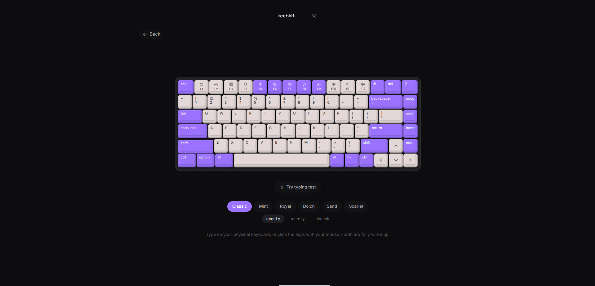

<div align="center">

# AuraKeys

**Themed mechanical keyboard simulator** with realistic switch sounds, haptic feedback, anime & GTA VI themes, and beautiful neon visuals.

[](https://mech-aurakeys.vercel.app)
[](./LICENSE)
[](https://github.com/haseeb45555)
[](https://www.linkedin.com/in/haseeb-ullah-0a64b9351/)

</div>

<br>

<p align="center">
  
</p>

**Live site:** https://mech-aurakeys.vercel.app  
**Author:** [Haseeb Ullah](https://www.linkedin.com/in/haseeb-ullah-0a64b9351/)

---

## Features

- 🎹 **Realistic mechanical sounds** – thocky clicks with multiple sound packs
- 📳 **Haptic feedback** – vibration on supported devices
- 🎨 **20+ themes** across 4 groups:
  - **Anime** → Gojo, Sukuna, Akatsuki, Eva-01, Tanjiro, Goku, Luffy, Levi, Naruto
  - **GTA VI** → Vice City (neon Miami), Leonida (golden hour)
  - **Games** → Minecraft, Valorant, Zelda, Mario
  - **Classic** → Classic, Mint, Royal, Dolch, Sand, Scarlet
- 🖼️ **Real artwork backgrounds** for anime & GTA themes
- ⌨️ **Layouts** → QWERTY, AZERTY, Dvorak
- ✨ Custom key legends, underglow, animated scenes
- 📱 Fully responsive + PWA ready

---

## Themes

| Group     | Themes                                                                 |
|-----------|------------------------------------------------------------------------|
| Anime     | Gojo, Sukuna, Akatsuki, Eva-01, Tanjiro, Goku, Luffy, Levi, Naruto    |
| GTA VI    | Vice City, Leonida                                                     |
| Games     | Minecraft, Valorant, Zelda, Mario                                      |
| Classic   | Classic, Mint, Royal, Dolch, Sand, Scarlet                             |

---

## Local Development

```bash
# Clone the repo
git clone https://github.com/haseeb45555/aurakeys.git
cd aurakeys

# Install dependencies
npm install

# Start dev server
npm run dev
```

Open http://localhost:5173

---

## Build & Deploy

```bash
npm run build
```

Deploy the `dist/` folder to **Vercel**, Netlify, or any static host.  
No extra config needed — it's a standard Vite + React app.

---

## Tech Stack

- React 19 + TypeScript
- Vite 7
- Tailwind CSS 4
- Lucide icons
- Web Audio API (sounds)
- Vibration API (haptics)

---

## License

MIT License © 2026 [Haseeb Ullah](https://www.linkedin.com/in/haseeb-ullah-0a64b9351/)

```
MIT License

Copyright (c) 2026 Haseeb Ullah

Permission is hereby granted, free of charge, to any person obtaining a copy
of this software and associated documentation files (the "Software"), to deal
in the Software without restriction, including without limitation the rights
to use, copy, modify, merge, publish, distribute, sublicense, and/or sell
copies of the Software, and to permit persons to whom the Software is
furnished to do so, subject to the following conditions:

The above copyright notice and this permission notice shall be included in all
copies or substantial portions of the Software.

THE SOFTWARE IS PROVIDED "AS IS", WITHOUT WARRANTY OF ANY KIND, EXPRESS OR
IMPLIED, INCLUDING BUT NOT LIMITED TO THE WARRANTIES OF MERCHANTABILITY,
FITNESS FOR A PARTICULAR PURPOSE AND NONINFRINGEMENT. IN NO EVENT SHALL THE
AUTHORS OR COPYRIGHT HOLDERS BE LIABLE FOR ANY CLAIM, DAMAGES OR OTHER
LIABILITY, WHETHER IN AN ACTION OF CONTRACT, TORT OR OTHERWISE, ARISING FROM,
OUT OF OR IN CONNECTION WITH THE SOFTWARE OR THE USE OR OTHER DEALINGS IN THE
SOFTWARE.
```

---

If you like AuraKeys, give it a ⭐ on GitHub. It really helps!
